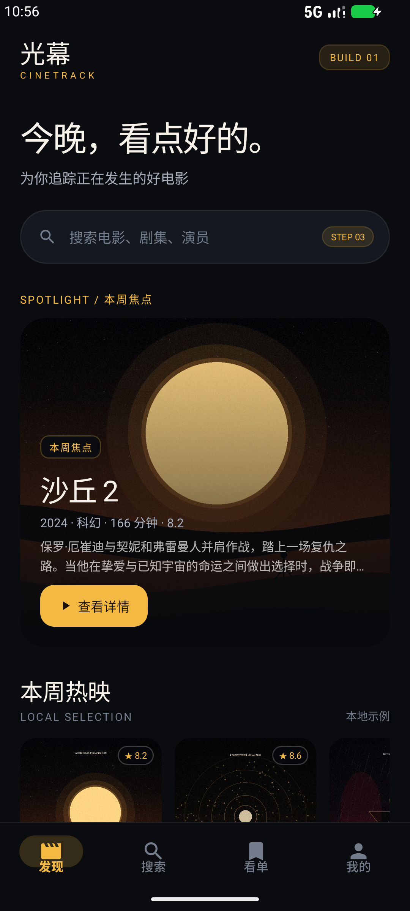

# 光幕 CineTrack · Step 01

原生 Android 影视追踪 App 的 **第 1 步：视觉地基与发现页**。

完整 13 步见 [PLAN.md](PLAN.md)。本版本只完成第 1 步，不提前实现后续能力。



## 第 1 步完成内容

- 完整 Android 工程（Java 17 + Material 3 + AndroidX）
- 阿里云 Maven 镜像（Google / Central / Gradle Plugin）
- 深色影院主题：黑金配色、编辑部式大标题、圆角卡片、氛围渐变
- 底部导航：发现 / 搜索 / 看单 / 我的
- 发现页：
  - 品牌区与 `BUILD 01` 标记
  - 祝福语式主标题
  - 搜索入口（标注第 3 步开放）
  - 本周焦点 Hero 卡
  - 本周热映横向海报列表
  - 即将上映横向海报列表，附日期角标
  - 路线图页脚
- 原创示例海报：沙丘 2、奥本海默、新蝙蝠侠、星际穿越，以及 3 部示例待映片
- 其余 Tab 的路线图占位页，明确下一步会加入什么
- 页面点击提供 Snackbar 路线反馈，不做假功能

## 本版刻意不包含

TMDb 网络请求、API Key、搜索、详情页、SQLite 看单、评分、上映提醒、海报磁盘缓存、设置中心。

这些会在第 2–13 步依次加入。

## 截图

| 发现 | 路线图占位 |
| --- | --- |
|  |  |

## 运行

1. Android Studio 打开 `CineTrack`。
2. Gradle JDK 选择 **JDK 21**（Gradle 8.13 不支持 JDK 25）。
3. Sync 后运行到 Android 8.0+ 模拟器或真机。

命令行：

```bat
set JAVA_HOME=C:\path\to\jdk-21
gradlew.bat assembleDebug
```

APK：`dist/CineTrack-step01.apk`

- SHA-256：`E38C5D6B703DEBF0CB3B9AF55BF4F023CD9BB471FC082F446ACCB55BAC1C2510`
- 使用本地 Debug 签名，仅用于演示安装。

## 技术信息

- 包名：`com.yjh.cinetrack`
- 版本：`0.1.0-step01`（versionCode 1）
- minSdk 26 / targetSdk 37 / compileSdk 37
- AGP 8.13.0 / Gradle 8.13
- Maven 镜像：阿里云
- Gradle 发行包镜像：腾讯云（阿里云 Maven 镜像不含 Gradle 发行包）

## 目录

```
CineTrack/
├─ app/src/main/java/com/yjh/cinetrack/
│  ├─ MainActivity.java
│  ├─ data/DemoCatalog.java
│  ├─ data/DemoMovie.java
│  ├─ ui/DiscoverFragment.java
│  ├─ ui/PlaceholderFragment.java
│  ├─ ui/MovieRailAdapter.java
│  └─ ui/PosterImageView.java
├─ app/src/main/res/
│  ├─ layout/                  # 发现页、占位页、卡片
│  ├─ drawable-nodpi/          # 原创示例海报
│  └─ values/                  # 黑金主题与文案
├─ docs/screenshots/           # 第 1 步实机截图
├─ dist/CineTrack-step01.apk   # 可安装 APK
├─ PLAN.md                     # 13 步计划
└─ README.md
```

## 验证

- API 37 模拟器（1080×2400）实际安装并运行
- 发现页、底部导航、占位页截图通过
- `assembleDebug` 通过
- `lintDebug` 通过

示例片单与海报为项目内原创生成素材，不含第三方版权图片。
